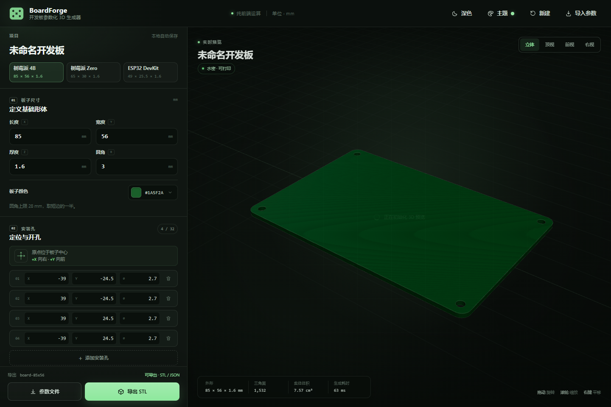
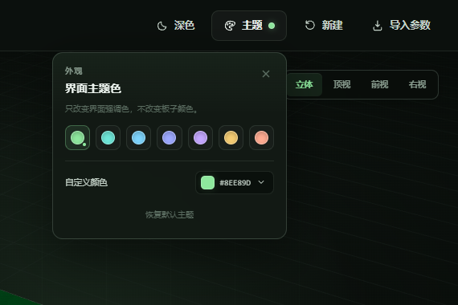
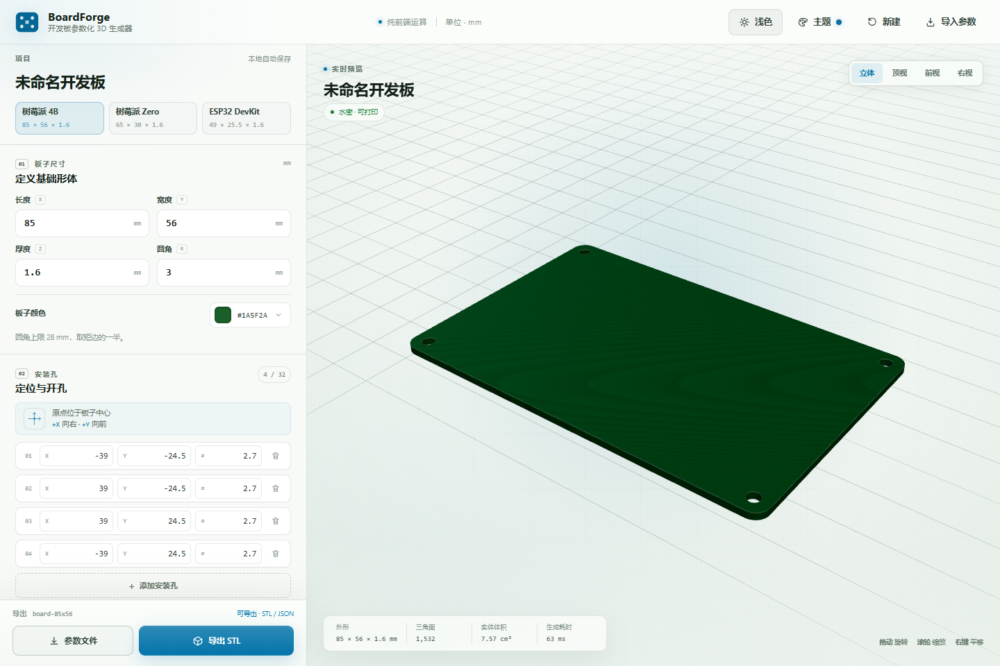

# BoardForge

开发板参数化 3D 模型生成器。输入板子的长、宽、厚、圆角和安装孔，实时得到带真实通孔的 3D 模型，并导出：

- **STL**：二进制、单位毫米、封闭可打印实体；
- **`.board.json`**：纯文本参数文件，可以再次导入继续编辑。

整个应用是纯前端实现，没有后端，也不上传任何模型或参数。



## 快速开始

### 直接使用单文件版本

打开：

```text
dist/index.html
```

这是一个已内联 CSS 和 JavaScript 的独立 HTML 文件，可以直接双击通过 `file://` 打开。无需服务器、无需网络。浏览器需要支持 WebGL。

### 本地开发

```bash
npm install
npm run dev
```

打开终端提示的地址（默认 `http://127.0.0.1:4173/`）。源码使用原生 ES Module 和 import map，不依赖框架。

### 构建单文件版本

```bash
npm run build
```

输出 `dist/index.html`，并打印原始体积和 gzip 体积。当前构建约为 **789 KB 原始 / 208 KB gzip**。

### 生成示例文件

```bash
npm run samples
```

会重新生成 `samples/` 中的 `.board.json` 和 `.stl`。

### 自动化验收

```bash
npm test
```

自动执行 105 项检查（42 项几何/schema/主题测试 + 63 项无头浏览器检查），包括实时重建、参数校验、CSG 回退路径、JSON 导入导出、二进制 STL 三角面/封闭流形检查、拖拽导入、深色/浅色模式切换与持久化、主题色、本地自动保存和移动端布局。测试截图输出到 `screenshots/`。

## 已实现功能

### MVP

- 长度、宽度、厚度、圆角半径参数输入，带范围校验；
- 安装孔增删和 X / Y / 直径编辑；
- Three.js 实时预览，支持旋转、缩放、平移和四个预设视角；
- 使用 `three-bvh-csg` 的真实布尔减法（Subtract）挖通孔；
- 模型水密性检查，未通过时阻止 STL 导出；
- 二进制 STL 导出，单位毫米，导出前进行拓扑检查；
- `.board.json` 导入/导出，也支持拖拽 `.board.json` 到页面；
- 本地自动保存，刷新后恢复上次参数。

### 额外完成

- 树莓派 4B、树莓派 Zero、ESP32 DevKit 三个预设；
- 深色 / 浅色模式一键切换，默认深色，偏好保存在本机；
- 板子颜色自定义（默认深绿色 `#1a5f2a`）；
- 界面主题色可设置：7 个预设色 + 任意自定义颜色，自动保存并跨刷新保留；
- 安装孔越界提示与自动跳过；
- 安装孔重叠提示；CSG 会实际合并重叠孔；
- 模型三角面数、实体体积、生成耗时统计；
- 文件名校验与自动命名（如 `board-85x56.stl`）；
- 深色桌面优先界面和可用的移动端布局；
- 独立单文件构建，可离线运行。



浅色模式：



## 参数文件

文件格式规范见 [docs/FORMAT.md](docs/FORMAT.md)。

约定：

- 原点在板子中心；
- **+X 向右**，**+Y 向前**（俯视时向上）；
- Z 轴为板厚方向，模型在 Z 方向居中；
- 所有长度单位为毫米。

界面主题色和深色/浅色模式保存在浏览器本地，不属于板子参数，因此不会写入 `.board.json`。板子本身的颜色仍由 `board.color` 控制。

示例：

```json
{
  "version": 1,
  "name": "Raspberry Pi 4B",
  "units": "mm",
  "board": {
    "length": 85,
    "width": 56,
    "thickness": 1.6,
    "corner_radius": 3,
    "color": "#1a5f2a"
  },
  "holes": [
    { "x": -39, "y": -24.5, "diameter": 2.7 },
    { "x": 39, "y": -24.5, "diameter": 2.7 },
    { "x": 39, "y": 24.5, "diameter": 2.7 },
    { "x": -39, "y": 24.5, "diameter": 2.7 }
  ],
  "meta": {
    "created": "2026-11-12T09:00:00+08:00",
    "updated": "2026-11-12T09:00:00+08:00"
  }
}
```

## 技术实现

### 依赖

- `three` — 渲染、几何和 OrbitControls；
- `three-bvh-csg` — 真实 CSG 布尔减法；
- `esbuild` — 仅用于生成单文件发行版；
- `playwright-core` — 自动化验收测试。

运行时没有 UI 框架、状态管理库、后端或网络请求。第三方 MIT 许可与版权声明见 [THIRD_PARTY_NOTICES.md](THIRD_PARTY_NOTICES.md)，构建时也会嵌入单文件 HTML。

### 模型生成流程

1. 使用 `THREE.Shape` 构建带圆角的矩形轮廓；
2. 拉伸为有厚度的板子（Z 方向居中）；
3. 用 `three-bvh-csg` 将每个安装孔圆柱从板子上 **Subtract** 掉；
4. 以 0.0001 mm 容差焊接顶点，检查边界边、非流形边和退化三角形；
5. 检查通过后加入预览并允许 STL 导出。

如果 CSG 内核在极端输入下失败或结果未通过水密检查，会退回到“带孔轮廓拉伸”的建模方式。该方式仍然生成真实的通孔，只是不能对重叠孔做并集。CSG 正常工作时（默认参数和常规输入）使用布尔路径。

### STL 导出

`src/stl-export.js` 是独立实现的最小二进制 STL writer：

- 80 字节 header；
- little-endian `uint32` 三角面数；
- 每个三角面 50 字节：法线 + 三个顶点 + 属性；
- 单位保持毫米，不缩放；
- 导出前检查坐标是否有效。

验收测试会重新解析导出的 STL，检查三角面数量、边界尺寸，并焊接顶点后确认每条边恰好被两个三角形共享，即封闭流形。

### 轻量策略

- 源码为原生 ES Module，无框架；
- 生产构建由 esbuild tree-shake 并压缩；
- 没有字体、图标库或外部 CDN 请求；图标为内联 SVG；
- 单文件构建可直接离线打开。

### 性能

- 默认 85 × 56 × 1.6 mm、4 孔：约 60–75 ms 完成 CSG 与拓扑检查；
- 参数输入使用约 48 ms 防抖，之后同步生成模型；
- 20 孔、200 × 150 mm 的压力测试约 0.39 s；
- 常见 20–200 mm 开发板尺寸都在设计范围内（参数上限为 500 mm）。

## 项目结构

```text
.
├─ index.html                 开发版页面
├─ styles.css                 界面样式
├─ src/
│  ├─ app.js                  表单、导入导出、交互和状态管理
│  ├─ board-geometry.js       圆角板、CSG 挖孔、水密性检查
│  ├─ preview.js              Three.js 场景、灯光、OrbitControls、视角
│  ├─ schema.js               参数规范化、校验、预设、文件名
│  ├─ stl-export.js           二进制 STL writer
│  └─ theme.js                深色/浅色模式、界面主题色和本地持久化
├─ scripts/
│  ├─ build.mjs               构建单文件版本
│  ├─ serve.mjs               零依赖静态服务器
│  ├─ generate-samples.mjs    生成示例 JSON/STL
│  ├─ test-geometry.mjs       schema 与几何单元检查
│  └─ test-app.mjs            浏览器端验收测试
├─ samples/                   示例参数文件和 STL
├─ screenshots/               桌面端、移动端和视角截图
├─ THIRD_PARTY_NOTICES.md     第三方 MIT 许可声明
├─ docs/
│  ├─ FORMAT.md               参数文件格式规范
│  └─ IMPLEMENTATION.md       实现说明与验收记录
└─ dist/index.html            独立可运行发行版
```

## 已知边界

- 当前只支持圆角矩形板，不支持异形多边形；
- 超出板边的孔会提示并跳过，不会自动裁切一个缺口；
- 重叠孔在 CSG 路径中会合并，直接建模回退路径会跳过重叠项；
- 不做外壳生成、账号、云存储、在线分享或元件库；
- 3D 预览需要 WebGL；STL/JSON 导出能力不依赖 WebGL（JSON 始终可用，STL 需要模型生成成功）。

## 示例产物

- `samples/raspberry-pi-4b.board.json`
- `samples/raspberry-pi-4b.stl`
- `samples/sensor-node-60x40.board.json`
- `samples/sensor-node-60x40.stl`
