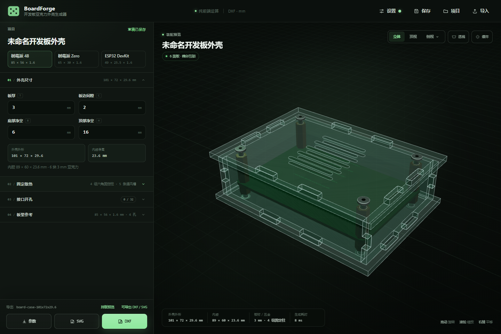
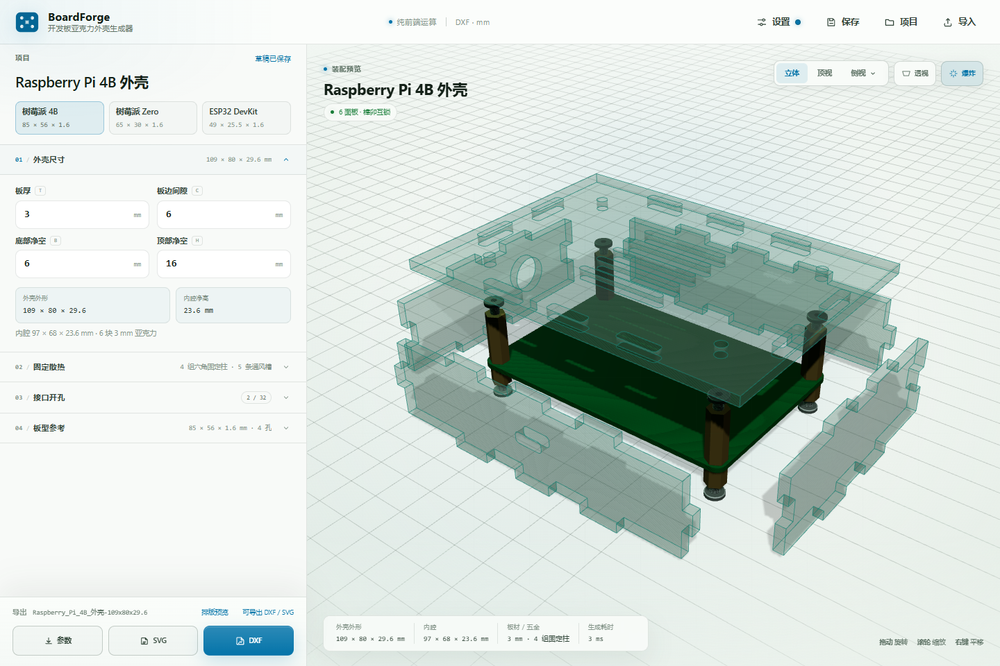
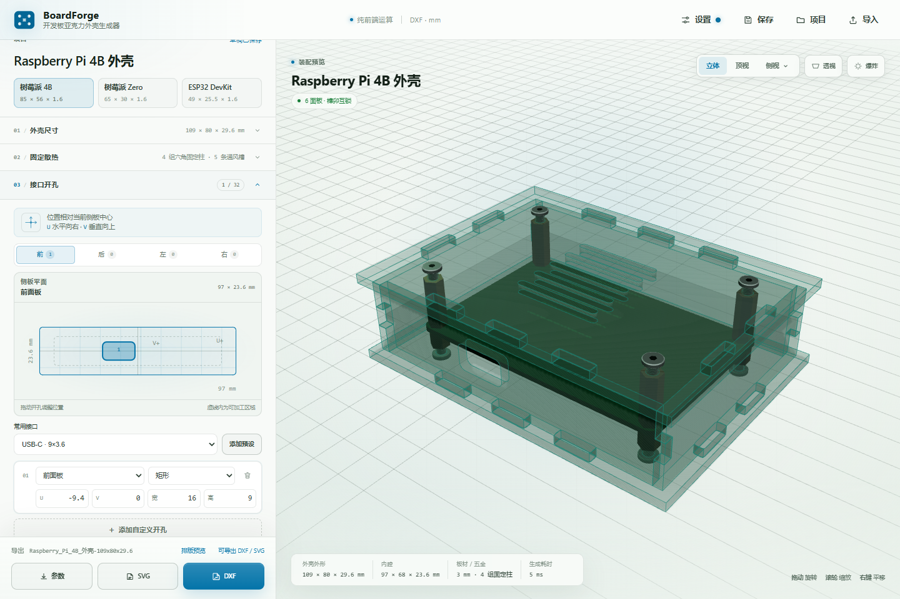
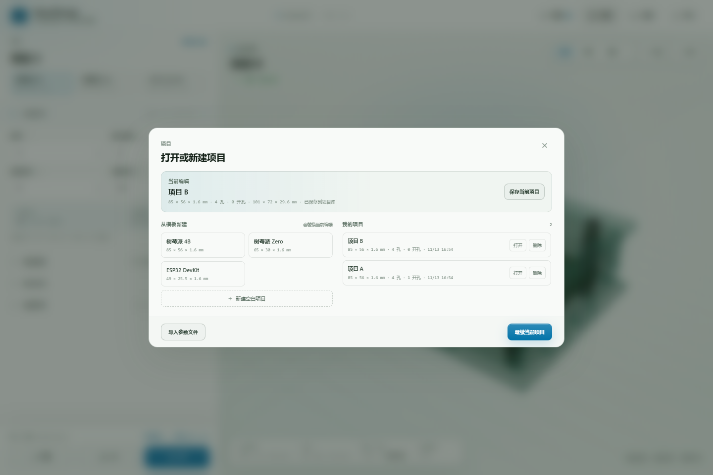
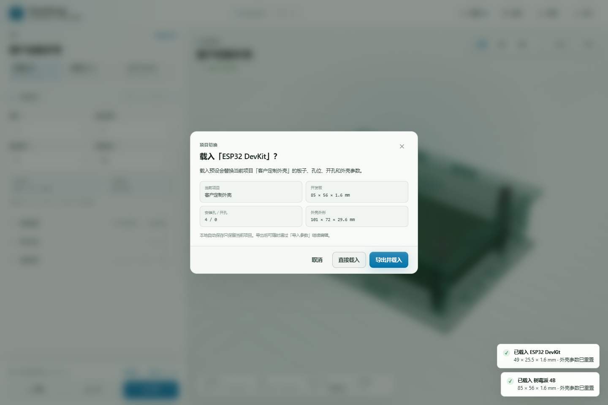
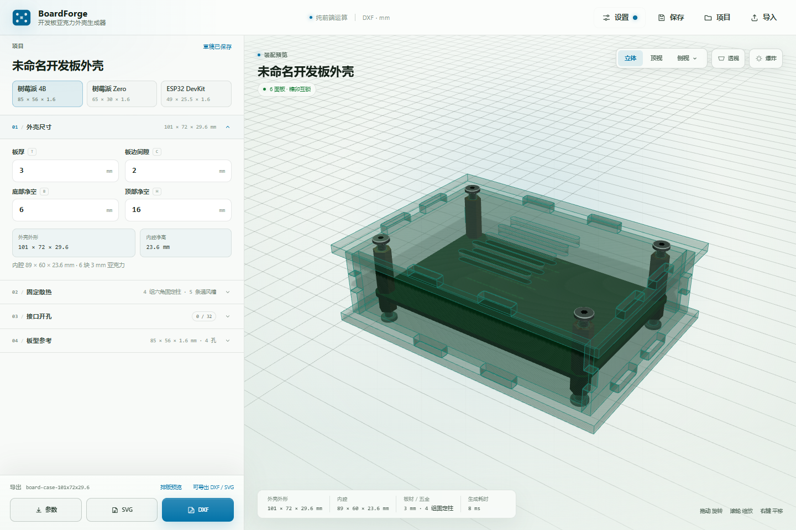
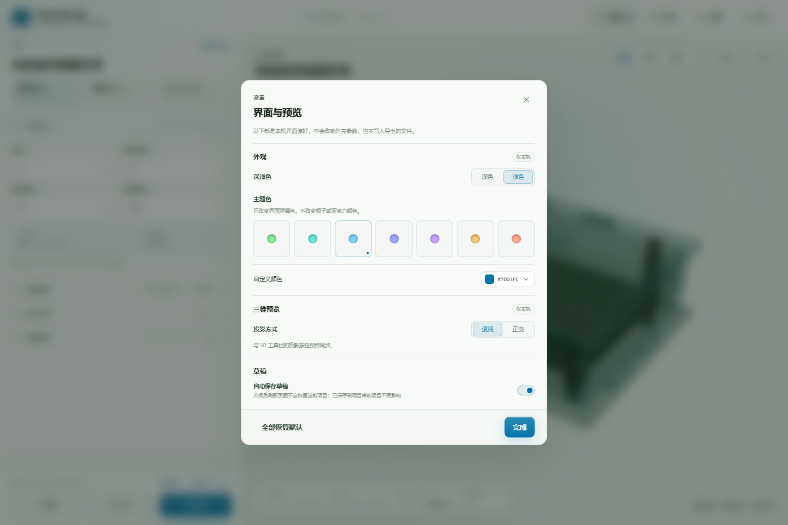
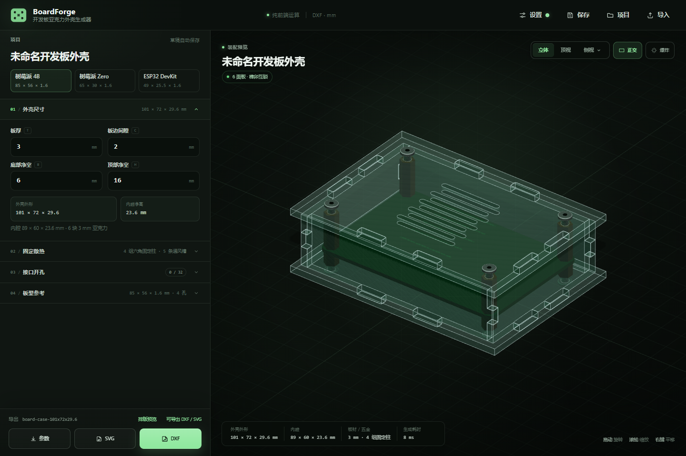
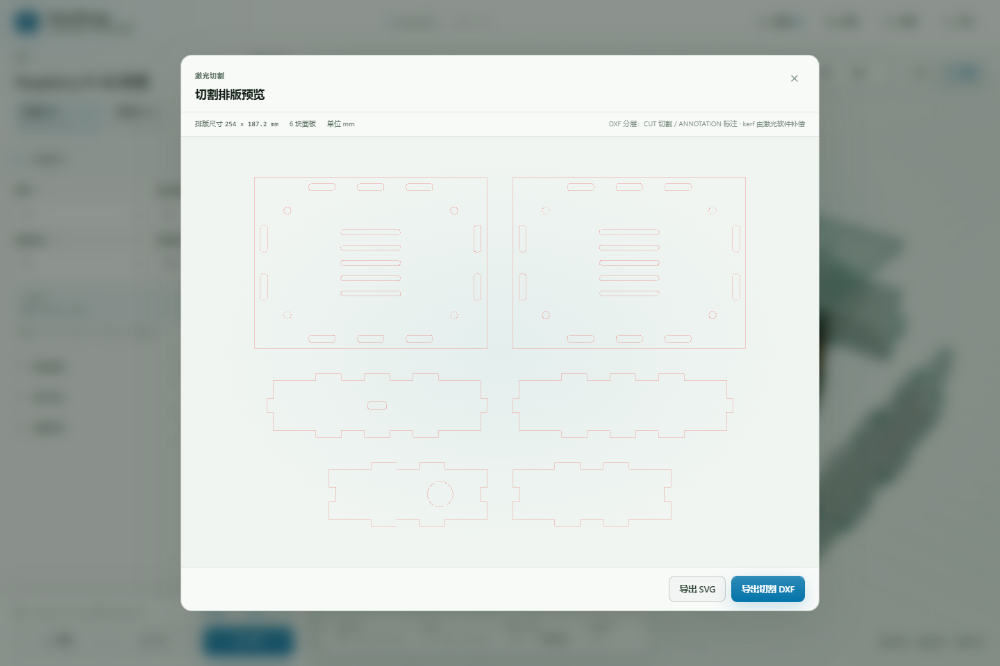

# BoardForge

开发板**亚克力六面外壳**参数化生成器。

输入开发板尺寸、安装孔、板材厚度和接口开孔，实时生成六块亚克力板互锁的完整盒体，并导出：

- **DXF**：六块面板的激光切割文件，单位毫米；
- **SVG**：同样的切割路径预览；
- **`.case.json`**：可再次导入继续编辑的外壳参数文件。

纯前端实现，没有后端，不上传任何参数或模型。



## 快速开始

### 直接使用

打开：

```text
dist/index.html
```

这是内联了 CSS 和 JavaScript 的独立 HTML 文件，可以直接双击通过 `file://` 打开，无需服务器和网络。浏览器需要支持 WebGL。

### 开发

```bash
npm install
npm run dev
```

打开 `http://127.0.0.1:4173/`。

### 构建

```bash
npm run build
```

输出单文件 `dist/index.html`，同时复制示例文件。

### 生成示例

```bash
npm run samples
```

生成 `samples/` 中的 `.case.json`、`.dxf` 和 `.svg`。

### 自动化验收

```bash
npm test
```

运行 284 项检查：

- 99 项 schema / 几何 / 导出单元检查；
- 185 项无头浏览器端到端检查。

测试覆盖六面板生成、一体固定柱、2D 开孔编辑与拖动、接口预设、制造冲突检查、五金 BOM、切割排版预览、侧边栏互斥折叠、参数联动、JSON 导入、DXF/SVG 导出、几何缓存、设置面板（深浅色 / 主题色 / 投影 / 自动保存）和移动端布局。

## 外壳结构

默认是一套完整六面盒：

- 顶板、底板、前面板、后面板、左面板、右面板共 6 块 3 mm 亚克力板；
- 侧板上下边缘通过榫舌插入顶/底板的**封闭槽**，顶/底板四周有 3 mm 外沿压住侧板；
- 前后板与左右板通过竖向榫舌/榫槽互锁，整体被顶/底板封闭槽限制，不能横向抽出；
- **一体化固定柱**直接使用开发板安装孔位：板子下方一段下柱、上方一段上柱，顶板和底板各用一颗螺丝，把顶板、板子、底板锁成同一组结构；3D 预览中固定柱为六角金属柱；
- 每组固定柱同时承担外壳连接和开发板支撑，不再另外设置四角角柱；
- 顶/底板可自动生成等距圆角通风槽；
- 侧板可以添加矩形或圆形 USB、HDMI、Type-C 等接口开孔。

默认开发板为 85 × 56 × 1.6 mm 的树莓派 4B 尺寸，外壳外形为 **101 × 72 × 29.6 mm**。侧板外轮廓为 95 × 66 mm，顶板和底板四周各有 3 mm 外沿，用封闭槽压住侧板，防止侧板横向抽出。开发板每边仍只有 2 mm 板边间隙。

> 固定柱过孔必须能穿过开发板对应的安装孔。若界面提示“板孔小于固定柱过孔”，请扩大板孔，或把固定柱过孔/五金改成与板孔匹配的规格。

> 这是激光切割 + 标准螺丝/螺柱的结构。侧板榫卯依赖材料厚度公差；导出的 DXF 是名义尺寸，建议先切一小段验证 3 mm 板材的实际厚度和激光补偿。



## 参数

### 开发板参考

- 长度、宽度、厚度、圆角；
- 安装孔 X / Y / 孔径；
- 板子颜色（仅 3D 参考模型）；
- 三个预设：树莓派 4B、树莓派 Zero、ESP32 DevKit。

开发板参数决定外壳内腔、固定柱位置、上下固定柱长度和整体外尺寸。

### 外壳

| 参数 | 默认值 | 说明 |
| --- | ---: | --- |
| 板厚 | 3 mm | 亚克力板厚度，同时决定榫槽宽度 |
| 板边间隙 | 2 mm | 开发板边缘到内腔侧壁的距离，默认紧凑贴合 |
| 底部净空 | 6 mm | 底板到开发板底面的下固定柱长度 |
| 顶部净空 | 16 mm | 开发板顶面到顶板内侧的上固定柱长度 |
| 五金规格 | M3 | 可选 M2 / M2.5 / M3 / M4，过孔分别为 2.4 / 2.9 / 3.4 / 4.5 mm |
| 榫卯配合间隙 | 0.15 mm | 榫舌/榫槽的单边配合余量 |

固定柱数量等于开发板有效安装孔数量。每组固定柱包含上下两段，分别位于板子的两面。

外壳尺寸自动推导：

```text
外壳宽 = 板长 + 2 × 板边间隙 + 2 × 板厚
外壳深 = 板宽 + 2 × 板边间隙 + 2 × 板厚
外壳高 = 2 × 板厚 + 底部净空 + 板厚 + 顶部净空
```

### 接口开孔

- 选择前面板、后面板、左面板或右面板；
- 选择矩形或圆形，或直接使用 USB-C / USB-A / HDMI / RJ45 / DC / 音频孔预设；
- `U` 为水平方向、`V` 为垂直方向，以侧板中心为原点；
- 在 2D 侧板平面编辑器中直接拖动开孔，数值同步更新；
- 超出可加工区域、重叠或被边缘榫槽影响的孔会被跳过，并在界面提示。



### 通风槽

- 顶板和底板同步生成；
- 可设置槽数量、槽宽和槽长；
- 自动居中、避开顶/底板上的固定柱过孔；
- 面板过小时会自动减少槽数并提示。

## 导出

### DXF

主导出格式。标准 ASCII DXF R12，单位毫米，所有六块面板排在一张切割图上。

- `CUT` 图层：闭合轮廓、开孔和通风槽，供激光切割；
- `ANNOTATION` 图层：图纸标题、板材厚度、比例、图层说明，以及每块面板的名称和尺寸；
- 完整包含 `HEADER`、`TABLES`、`BLOCKS`、`ENTITIES`，并定义 `LTYPE`、`LAYER`、`STYLE` 表和文字样式；
- 切割图层与参考标注分离，CAD 和激光软件中可单独关闭标注层。

DXF 不包含激光补偿；请在激光软件中按材料测试结果设置 kerf。

### SVG

与 DXF 相同的面板切割路径，适合预览、排版检查或交付给支持 SVG 的切割服务。

### 参数文件

`.case.json` 是 UTF-8 JSON，包含开发板、外壳、开孔、通风和元数据。格式规范见 [docs/FORMAT.md](docs/FORMAT.md)。

## 功能

- 六面板亚克力榫卯外壳实时 3D 预览；
- 顶/底板带 3 mm 外沿和封闭侧板槽，侧板插入后不能横向抽出；
- 侧边栏模块化折叠，一次只展开一个主要模块，折叠时仍显示关键尺寸摘要；
- 透视投影 / 正交投影一键切换，偏好保存在本机；
- 立体 / 顶视保留为一级按钮，前 / 后 / 左 / 右四个正视角收进「侧视」菜单；侧视垂直于对应面板，配合正交投影方便设置接口开孔；
- 从顶视或侧视手动拖动旋转时，会自动回到立体自由视角；
- 前后 / 左右切换沿模型圆弧旋转 180°，不会穿过模型中心；
- 爆炸视图；
- 板子参考模型和安装孔驱动外壳固定柱；
- 侧板 2D 平面编辑器：毫米网格、安全边距、拖动开孔、四块侧板切换；
- USB-C、USB-A、HDMI、RJ45、DC、3.5 mm 音频等常用接口预设；
- 自动通风槽；
- 切割排版预览；
- 六角固定柱五金 BOM、长度建议和板孔兼容性提示；
- 固定柱和面板螺丝按 M2 / M2.5 / M3 / M4 标准公制规格选择，过孔自动匹配；
- 3D 预览中固定柱为六角柱，8 颗面板螺丝为圆角平头造型，带六角槽和穿过面板的螺纹螺杆；
- 开孔重叠、板孔过近等制造冲突检查；
- DXF / SVG / JSON 三种导出；
- 启动项目库：可从预设新建、打开自己的项目、保存当前项目和删除项目；
- 支持在本机保存多个项目，切换项目时对未保存修改给出保护提示；
- 切换开发板预设或新建前，若当前项目已自定义，会提示先导出参数；
- 拖拽 `.case.json` 导入，兼容旧 `.board.json`；
- 参数范围校验；
- 设置面板：深色 / 浅色、主题色、投影方式和草稿自动保存开关；
- 当前草稿自动保存（可在设置中关闭）；
- 桌面和移动端布局。

项目库与启动页：



项目替换保护：





设置面板（深浅色、主题色、投影方式、自动保存）：



正交投影模式：



切割排版预览：



## 项目结构

```text
.
├─ index.html                 开发版页面
├─ styles.css                 界面样式
├─ src/
│  ├─ app.js                  参数、预览、导入导出和交互
│  ├─ case-schema.js          外壳文档格式、默认值、尺寸推导
│  ├─ case-geometry.js        六面板榫卯几何、开孔、通风、固定柱
│  ├─ preview.js              Three.js 透明亚克力装配预览
│  ├─ vector-export.js        DXF/SVG 切割文件生成
│  ├─ board-geometry.js       开发板参考模型与 CSG 挖孔
│  ├─ schema.js               开发板参数与预设
│  └─ theme.js                深浅色、界面主题色和本地持久化
├─ scripts/
│  ├─ build.mjs               构建单文件版本
│  ├─ serve.mjs               零依赖静态服务器
│  ├─ generate-samples.mjs    生成示例 JSON/DXF/SVG
│  ├─ test-geometry.mjs       schema/几何/导出单元测试
│  └─ test-app.mjs            浏览器端验收测试
├─ samples/                   示例外壳参数和切割文件
├─ screenshots/               桌面端、移动端、爆炸和开孔截图
├─ docs/
│  ├─ FORMAT.md               外壳参数文件规范
│  └─ IMPLEMENTATION.md       实现说明
└─ dist/index.html            独立可运行发行版
```

## 构建与性能

- `dist/index.html` 约 **916 KB 原始 / 236 KB gzip**；
- 开发板参考几何按板尺寸/孔位缓存，只修改外壳参数时不会重复执行 CSG；
- 默认 85 × 56 mm 外壳构建约 70–110 ms；
- 生产构建使用 esbuild tree-shake 和压缩；
- 无外部字体、图标库或 CDN 请求。

## 示例文件

- `samples/raspberry-pi-4b-case.case.json`
- `samples/raspberry-pi-4b-case-cut.dxf`
- `samples/raspberry-pi-4b-case-cut.svg`
- `samples/sensor-node-case.case.json`
- `samples/sensor-node-case-cut.dxf`
- `samples/sensor-node-case-cut.svg`

树莓派示例按实际 2.7 mm 板孔使用 2.9 mm 固定柱过孔；Sensor Node 示例使用 3.2 mm 板孔和 3.4 mm 过孔，分别对应 M2.5 / M3 五金。

## 已知边界

- 目前只有矩形六面盒，不支持斜面、异形轮廓或圆角外框；
- 多项目库保存在浏览器 `localStorage`，清理站点数据会删除，重要项目请导出 `.case.json`；
- 关闭「自动保存草稿」后，刷新页面不会恢复未保存的编辑；已保存到项目库的项目不受影响；
- 接口开孔需要手动设置位置，不自动识别板上的连接器；
- 一体化固定柱要求开发板安装孔能穿过对应的螺柱/螺丝；板孔较小时界面会提示改小过孔或扩孔；
- 亚克力榫卯公差受板材实际厚度、激光 kerf 和装配方式影响；DXF/SVG 仍是名义路径，kerf 由激光软件或测试后的 `fit` 参数补偿；
- 切割排版会显示总幅面，但暂不根据具体激光机幅面自动旋转/重新排样；
- 3D 预览中的透明材质和硬件是视觉近似；
- 不包含带尺寸标注的工程图、五金采购链接或 3MF 导出；BOM 目前是复制文本，不是供应商订单。

## License

第三方 MIT 许可见 [THIRD_PARTY_NOTICES.md](THIRD_PARTY_NOTICES.md)。
